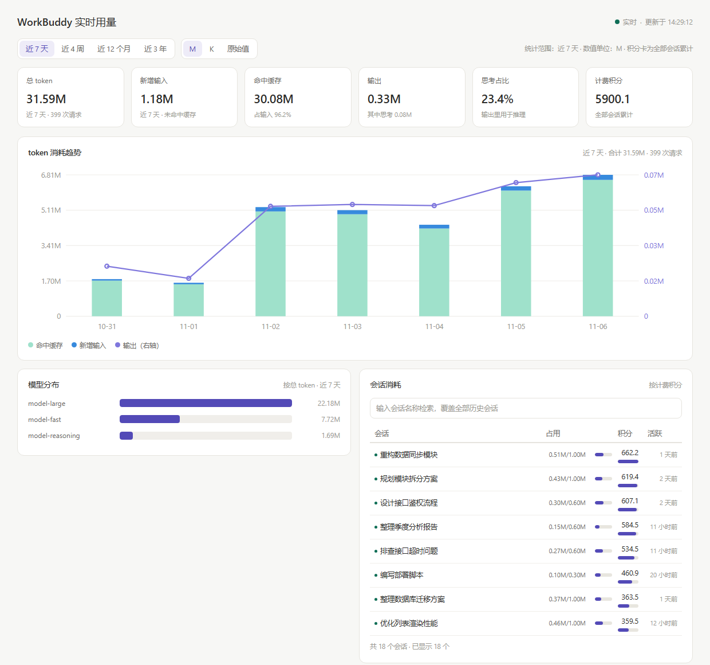

# WorkBuddy Usage Dashboard

实时查看 WorkBuddy 的 token 消耗、上下文占用、思考量与计费积分。
**单个 exe，双击即用，不需要 Python，不需要插件。**



> 上图由 `--demo` 模式生成，是构造出来的演示数据，不含任何真实记录。

---

## 为什么做这个

WorkBuddy 的界面只给一个上下文占用百分比和积分，看不到每次请求的 token 明细，
也不知道模型把多少输出花在了思考上。但这些数据其实完整落在本地
`~/.workbuddy/traces/*.jsonl` 里 —— 每条都是一次完整的 API 响应，带着 `usage` 字段。
这个项目把它们读出来并可视化，全程只读、不出机器。

它同时也是一次「上游升级不用重写」的实践：所有对 WorkBuddy 内部格式的依赖，
都被收敛在 Adapter 层。格式变了只需要改一个文件。

---

## 一、交付形式

| 项目 | 内容 |
|---|---|
| 文件 | `WorkBuddy用量看板.exe`（单个文件，约 8.9 MB） |
| 形态 | 免安装绿色程序，拷到任意目录双击即可 |
| 依赖 | 无。Python 运行时已打包进 exe |
| 附带文件 | 一个都不需要 |
| 卸载 | 直接删 exe；想清干净再删 `C:\Users\<你>\.workbuddy-usage\` |

---

## 二、运行前提

必须满足的：

1. **Windows 10 / 11，64 位**（exe 是 x64 构建，32 位系统跑不了）。
2. **本机装过并运行过 WorkBuddy**。看板读的是 `%USERPROFILE%\.workbuddy\` 下的本地数据，没这个目录就没有数据可看。

不需要的：

- 不需要 Python、Node、任何 SDK
- 不需要联网（完全本地，数据不出机器）
- 不需要管理员权限
- 不需要 WorkBuddy 开着（有历史 trace 就能看）

---

## 三、使用方法

1. 把 `WorkBuddy用量看板.exe` 放到任意位置（桌面、U 盘都行，路径带中文也没问题）。
2. **双击**。
3. 会弹出一个黑色命令行窗口，显示服务地址和数据源状态，**浏览器自动打开看板**。
4. 看板实时刷新。**关掉黑色窗口 = 停止服务。**

窗口里大概长这样：

```
============================================================
  WorkBuddy 用量看板
============================================================
  地址      http://127.0.0.1:17787/
  数据目录  C:\Users\你\.workbuddy-usage
  数据源    trace    正常  抽样 3 个文件
  数据源    sqlite   正常  可读 50 个会话
============================================================
  浏览器会自动打开；关掉这个窗口即停止服务。
============================================================
```

可选参数（一般用不上）：

```
WorkBuddy用量看板.exe --probe        只看数据源能不能读到
WorkBuddy用量看板.exe --demo         用演示数据启动，不读任何真实记录
WorkBuddy用量看板.exe --once         只采一轮，打印汇总就退出
WorkBuddy用量看板.exe --port 18888   指定端口
WorkBuddy用量看板.exe --no-browser   不自动开浏览器
```

---

## 四、看板上有什么

### 1. 时间范围切换

左上角四个按钮切换**统计粒度**，趋势图、KPI 卡片、模型分布会一起跟着变，不会出现「图是近 7 天、模型却是全部历史」这种自相矛盾：

| 按钮 | 窗口 | 每根柱子代表 |
|---|---|---|
| 近 7 天 | 今天往前 7 天 | 一天 |
| 近 4 周 | 含本周在内的 4 个自然周（周一起算） | 一周 |
| 近 12 个月 | 含本月在内的 12 个月 | 一个月 |
| 近 3 年 | 含今年在内的 3 个自然年 | 一年 |

没有数据的时间段会**保留空柱子**而不是跳过，否则「停用了一周」会看成「天天都在用」。

> 唯一不随范围变的是「计费积分」卡片 —— 积分是每个会话的生命周期累计值，按天拆不出来，所以它固定显示全部会话累计，数值后面的小字也这么标注。

### 2. 数值单位切换

三个按钮切换**显示单位**：`M`（百万）/ `K`（千）/ `原始值`（精确到个位，带千分位）。

影响范围包括 KPI、坐标轴、模型分布、会话占用列和所有悬停提示；百分比和积分不受影响。数字为 0 时直接显示 `0`，不写 `0.00M`。

### 3. 会话检索

会话卡片顶部的搜索框按**会话名称**模糊匹配，检索的是服务端累计的**全部历史会话**，不受「只显示前 N 条」的限制，消耗再小也能查到（哪怕积分只有 0.01）。

- 输入即搜（防抖 280ms），清空即恢复全量
- 列表固定高度、内部滚动，滚到底自动加载下一页，也可以点「加载更多」
- 底部实时显示「共 137 个会话 · 已显示 24 个」这类计数
- 会话前的小圆点是状态：绿色表示这次采集时上游还在，灰色表示这个会话在上游已经被关掉了 —— 但记录仍然保留，照样能搜到

三个控件都可以写进 URL 分享：

```
http://127.0.0.1:17787/?gran=month&unit=K
http://127.0.0.1:17787/?gran=week&q=部署
```

`gran` 取 `day|week|month|year`，`unit` 取 `M|K|raw`，`q` 是检索词。不加参数时用上一次的选择（记在浏览器本地）。

---

## 五、换电脑 / 多人使用

把 exe 拷过去双击就行。注意三点：

1. **数据不跟着走**。每台机器扫自己的 `.workbuddy`，所以 A 电脑的看板只显示 A 电脑的用量，这是对的。
2. **首次运行会自动建目录**（`%USERPROFILE%\.workbuddy-usage\`）并全量重扫一遍历史 trace，通常几秒到几十秒，看数据量。
3. **端口可能不一样**。默认 `17787`，如果这台机器上被别的程序占了，会自动往后顺延，以窗口里显示的地址为准。

---

## 六、常见问题

**双击后窗口一闪就没了**
说明启动阶段报错了。改成在命令行里跑一次看完整报错：
`WorkBuddy用量看板.exe --probe`
或者看日志：`%USERPROFILE%\.workbuddy-usage\logs\wbum.log`

**浏览器没自动打开**
手动在地址栏输入窗口里显示的地址（默认 `http://127.0.0.1:17787/`）。

**提示"已经在运行了"**
说明上一次的窗口还开着（没关干净）。它不会重复启动第二个服务，而是直接打开已有的看板。想重开就先关掉之前的黑窗口。

**数据是空的 / 显示 0**
窗口里的"数据源"行会说明原因：
- `未找到 trace 文件` → 这台机器还没用过 WorkBuddy，或者 `.workbuddy` 不在默认位置
- `数据库不存在` → 同上

这种情况下看板仍然能打开，只是没数据。

**杀毒软件报毒**
PyInstaller 打包的程序被误报是常见现象。可以加白名单，或者改用源码方式跑（见下方开发者部分）。

**数字怎么和我理解的不一样**
- 输入 token 是**每轮全量重发**的累计值，所以数字很大；其中 98% 命中前缀缓存，实际计费便宜很多。
- "思考占比"是推理 token 占输出的比例。WorkBuddy 只回传思考的 token 数，不回传思考文本。
- "计费积分"来自 WorkBuddy 自己的 `credit`，和 token 不是线性对应。

---

## 七、开发者部分

### 从源码运行（改代码时用）

```bash
cd tools/wb-usage-monitor
python main.py            # 需要 Python 3.9+
```

### 重新打包 exe

```bash
pip install pyinstaller pillow
python -m PyInstaller --onefile --console --clean --noconfirm \
  --name "WorkBuddy用量看板" --icon app.ico --add-data "web;web" main.py
# 产物在 dist/
```

### 目录结构

```
wb-usage-monitor/
├── main.py                 入口：端口选择、启动横幅、自动开浏览器
├── config.py               所有可调常量（路径、端口、间隔、字段映射）
├── contracts.py            数据契约：UsageRecord / SessionSnapshot / Capability
├── server.py               HTTP + SSE（标准库）
├── verify.py               V1~V11 验证脚本
├── app.ico                 图标
├── adapters/
│   ├── trace_adapter.py    ← 唯一认识 WorkBuddy trace 格式的地方
│   ├── sqlite_adapter.py   ← 唯一认识 WorkBuddy 数据库 schema 的地方
│   └── demo_adapter.py     演示数据，`--demo` 用，不读真实文件
├── core/
│   ├── store.py            SQLite 落库、增量水位、聚合
│   └── engine.py           调度、健康状态、广播
└── web/index.html          看板（手写 SVG，无 CDN 依赖）
```

### WorkBuddy 升级后改哪里

| 变化 | 只改这里 |
|---|---|
| trace 目录改名 | `config.TRACE_GLOB_DIR` |
| usage 字段改名 | `config.USAGE_MAP` |
| trace 结构改版 | `adapters/trace_adapter.py` 的 `parse_line()` |
| 数据库改表 | `config.SQLITE_COLUMNS` 或 `sqlite_adapter.py` |
| 新增数据源 | 新写一个 Adapter，其它层不动 |

能力自检每 5 分钟跑一次，解析失败率超 10% 就进入 `DEGRADED`：界面顶部黄条告警，继续显示最后一次有效数据，不崩。

### 验证

```bash
python verify.py          # 全部
python verify.py v3 v9    # 指定项
```

| # | 用例 | 实测 |
|---|---|---|
| V1 | 数据完整性 | 与独立重算差异 0 |
| V2 | 幂等性 | 重复采集 3 次均新增 0 |
| V3 | 实时延迟 | P50 397ms / P95 602ms |
| V4 | 断点续采 | 半行不误计，补全后不漏 |
| V5 | 格式漂移 | 改名/半行/坏行/缺库/缺目录 均不崩 |
| V6 | 资源占用 | CPU 3.7% / RSS 33MB |
| V7 | 短稳 60s | RSS 增长 0% |
| V8 | 只读安全 | WorkBuddy 文件指纹零变动 |
| V9 | 可插拔 | 假 Adapter 顶替后 Core/UI 零改动 |
| V10 | 时间粒度分桶 | 7/4/12/3 桶，合计与独立重算一致，空桶保留、区间连续 |
| V11 | 会话检索 | 翻页不重不漏、最小消耗会话可查、通配符转义、离线会话仍保留 |

### exe 专项验收（2026-11-06）

| 场景 | 结果 |
|---|---|
| 默认启动 | 端口 17787，健康 OK，页面 200 |
| 重复双击 | 识别已有实例，直接打开，不启第二个 |
| 连续重启 3 次 | 端口稳定不跳（覆盖 TIME_WAIT） |
| 端口被别的程序占用 | 自动顺延并提示换了端口 |
| 全新数据目录 | 自动建库 + 全量重扫历史 trace |
| 无 WorkBuddy 环境 | 不崩溃，明确报两个数据源异常 |

---

## 八、已知限制

1. **实时性上限取决于 WorkBuddy 何时把 trace 刷到磁盘**。采集侧 P95 是 602ms，但 WorkBuddy 并非每条请求立刻落盘，存在批量写入间隔。
2. **看不到思考文本**。全量 1,500+ 条响应里 `reasoning_content` 一条都没有，网关只回传 `reasoning_tokens` 计数。所以只能看"思考占输出 52%"，看不到思考了什么。
3. **端口 17787 仅本机监听**（127.0.0.1），不对局域网暴露。
4. **V7 只跑了 60 秒**，8 小时长稳需要真正长跑。
5. **计费积分不能按时间范围拆**。积分是 WorkBuddy 按会话记的账，没有按天的明细，所以那张卡片固定显示全部会话累计。
6. **会话翻页按「实时在线优先、积分降序」排序**。如果一边翻页一边有新会话冒出来，理论上可能漏掉一条（去重能防重复，防不了位置后移）。数据量级别下影响很小。
7. **会话历史从本工具首次运行开始累积**。更早的会话如果 WorkBuddy 自己已经删掉，这边也没法凭空补出来。

---

## License

MIT，见 [LICENSE](LICENSE)。

这个项目只读取 WorkBuddy 在本机生成的文件，不修改、不上传，也不包含任何 WorkBuddy 的代码或资源。
